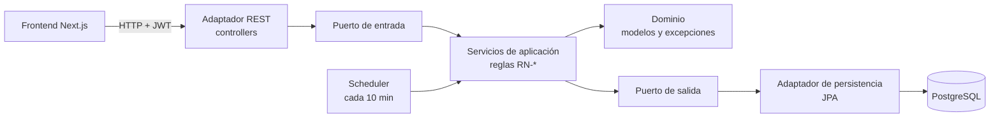

# Field Reserve · API de reservas de canchas deportivas con bodega

Backend para administrar un complejo deportivo: reservas de canchas por hora con adelantos y pagos, caja de cancha y una bodega con inventario, compras, ventas y caja propia. Pensado para el día a día de un encargado y para que el administrador vea en un solo reporte lo que ingresa por la cancha y por la bodega.

**Frontend:** [field-reserve-frontend](https://github.com/nestoredidev/field-reserve-frontend) (Next.js 16, React 19, TypeScript y Tailwind CSS)

<!-- Agrega aquí 2 o 3 capturas del sistema: calendario de reservas, cobro de una reserva y reporte general. -->

## Qué resuelve

- **Sin cruces de horario.** Reservas y mantenimientos comparten la misma agenda: si un horario choca, la API responde `409` con la lista de reservas en conflicto. Las reservas contiguas sí se permiten.
- **Monto calculado por el backend.** Se suma hora por hora el precio de cada franja según la tarifa de la cancha.
- **Ciclo de vida con adelanto.** `PENDIENTE → CONFIRMADA → COMPLETADA`, más `CANCELADA` y `NO_ASISTIO`. La reserva se confirma al pagar el adelanto mínimo (50 %, configurable). Si no se paga a tiempo, un proceso automático la cancela cada 10 minutos.
- **Pagos que no se pueden alterar.** No se editan ni se borran. No superan el saldo, y no se acepta dos veces el mismo número de operación con el mismo método. Las devoluciones las registra solo el administrador.
- **Bodega con kardex.** Productos, compras a proveedores, ventas y caja de bodega, con bloqueo pesimista del stock para que dos ventas simultáneas no lo descuadren.
- **Reportes.** Ganancia por producto y resumen general de cancha y bodega por rango de fechas.
- **86 reglas de negocio con código.** Cada error lleva su código (`RN-RES-06`, `RN-PAG-03`…), así el frontend y el soporte saben exactamente qué regla se incumplió.

## Stack

| Capa | Tecnologías |
|------|-------------|
| Backend | Java 21, Spring Boot 4.1, Spring Security, JWT (jjwt), Spring Data JPA, MapStruct, Lombok |
| Base de datos | PostgreSQL 16 (esquema en `bd.sql`), zona horaria America/Lima |
| Documentación | OpenAPI / Swagger UI, `ENDPOINTS.md` |
| Tests | JUnit 5, Testcontainers con PostgreSQL real: 46 clases de test de servicio, controlador y repositorio |
| Entorno | Docker Compose |

## Arquitectura

Arquitectura hexagonal por módulo: el dominio no depende de Spring ni de JPA. Los casos de uso hablan con el exterior a través de puertos, y los adaptadores REST y de persistencia los implementan.



```
src/main/java/nestoredidev/
├── reserva/      reservas, mantenimientos, pagos y cancelación automática
├── cancha/       canchas y tarifas por franja
├── cajacancha/   apertura, cierre y movimientos de la caja de cancha
├── cliente/      clientes (aviso a partir de 2 inasistencias)
├── bodega/       categoria · producto (kardex) · proveedor · compra · venta · caja
├── reporte/      ganancia por producto y resumen general
├── usuario/      autenticación JWT, roles ADMIN y ENCARGADO
└── common/       respuestas, paginación y manejo global de errores
```

Cada módulo sigue `domain/`, `application/` (servicios y puertos) e `infrastructure/` (adaptadores).

## Roles

| Rol | Puede |
|-----|-------|
| `ADMIN` | Todo: usuarios, tarifas, mantenimientos, devoluciones, ajustes de monto y reportes. |
| `ENCARGADO` | El día a día: reservas, cobros, ventas, compras, abrir y cerrar caja, clientes y proveedores. |

## Cómo ejecutarlo

Requisitos: Java 21 y Docker.

```bash
git clone https://github.com/nestoredidev/field-reserve-backcend.git
cd field-reserve-backcend
./gradlew bootRun
```

Spring Boot levanta PostgreSQL con `compose.yaml` y aplica `bd.sql` la primera vez. La API queda en `http://localhost:8080/api/v2` y Swagger UI en `http://localhost:8080/swagger-ui.html`.

**Datos de prueba (opcional):** con el contenedor encendido, carga `seed/seed.sql`. Crea canchas, clientes, reservas en todos los estados, cajas, productos, una compra y ventas. Los usuarios de prueba están en [`seed/README.md`](seed/README.md).

### Configuración

| Propiedad | Variable de entorno | Defecto |
|-----------|---------------------|---------|
| `app.jwt.secret` | `JWT_SECRET` | secreto de desarrollo (cámbialo en producción, mínimo 32 caracteres) |
| `app.bootstrap.admin-password` | `ADMIN_PASSWORD` | contraseña inicial del usuario `admin` |
| `app.reserva.adelanto-porcentaje` | — | `0.50` |

## Tests

```bash
./gradlew test
```

Necesitan Docker encendido: Testcontainers levanta un PostgreSQL real para los tests de repositorio, así que las consultas se prueban contra la misma base que en producción.

## Documentación de la API

- [`ENDPOINTS.md`](ENDPOINTS.md): todos los endpoints, con las reglas de negocio de cada uno, ejemplos de respuesta y códigos de error.
- Swagger UI: `http://localhost:8080/swagger-ui.html` con la app encendida.

## Autor

**Nestor Edi Cacha Celmi** · Desarrollador Backend Java · [nestoredi.dev](https://www.nestoredi.dev/) · [LinkedIn](https://linkedin.com/in/nestordev)
